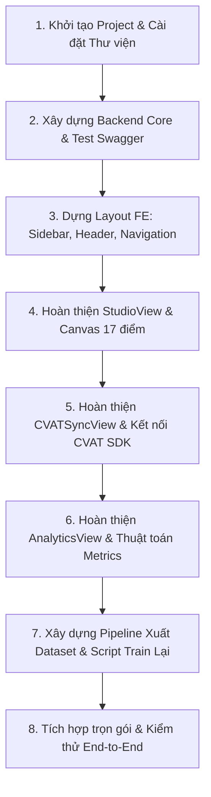

# KẾ HOẠCH TRIỂN KHAI DỰ ÁN & ĐỀ XUẤT KIẾN TRÚC TỐI ƯU
> **Dự án**: Nền tảng tự động tiền gán nhãn Pose (17 Keypoints COCO) tích hợp YOLO 26 Pose & CVAT Local  
> **Tech Stack**: Backend FastAPI (Python) + Frontend React (Vite) + Tailwind CSS + YOLO 26 Pose + CVAT SDK  
> **Phiên bản kiến trúc**: 1.2 (Chuẩn hóa kiến trúc Layout & Views chuyên nghiệp cho Frontend)

---

## PHẦN 1: ĐỀ XUẤT CẤU TRÚC THƯ MỤC TỔNG THỂ (ENTERPRISE-GRADE)

Cấu trúc Frontend được tách bạch rõ ràng giữa:
1. **`layouts/`**: Khung sườn cố định (Sidebar điều hướng bên trái, Header trạng thái trên cùng).
2. **`views/` (hoặc `pages/`)**: Các màn hình làm việc chính độc lập (Studio gán nhãn, Quản lý CVAT, Dashboard đo lường).
3. **`components/`**: Các khối giao diện con tái sử dụng (Canvas vẽ khung xương, nút bấm, modal, sliders).

```
pose-prelabel-app/
│
├── backend/
│   ├── weights/               # Chứa file weights model YOLO 26 (yolo26-pose.pt)
│   ├── config.py              # Quản lý biến môi trường (.env), URL CVAT, port, dir paths
│   ├── schemas.py             # Pydantic models (Validate request/response giữa FE & BE)
│   ├── model_service.py       # Load model YOLO 26 & inference batch 17 keypoints (GPU/CPU)
│   ├── converter.py           # Chuyển đổi YOLO Output -> CVAT Skeleton Format (JSON/Datumaro)
│   ├── cvat_client.py         # Kết nối CVAT SDK / REST API (Login, tạo task, upload ảnh, push nhãn)
│   ├── metrics.py             # Tính toán PCK, NME, Human Correction Rate
│   ├── train_yolo26.py        # [MỚI] Script mẫu huấn luyện / fine-tune lại YOLO 26 từ dataset mới
│   ├── main.py                # FastAPI App, CORS, Static files & API Endpoints
│   └── requirements.txt       # Danh sách thư viện Python cần thiết
│
├── frontend/                  # React (Vite) + Tailwind CSS
│   ├── src/
│   │   ├── layouts/           # KHUNG SƯỜN CỐ ĐỊNH (LAYOUT & NAVIGATION)
│   │   │   ├── MainLayout.jsx # Layout tổng: Sidebar cố định bên trái + Header trên + Vùng nội dung
│   │   │   ├── Sidebar.jsx    # Menu điều hướng chuyên nghiệp (Studio, CVAT Hub, Analytics)
│   │   │   └── Header.jsx     # Topbar: Live status CVAT/BE, Model active, Dark/Light toggle
│   │   │
│   │   ├── views/             # CÁC MÀN HÌNH NỘI DUNG CHÍNH (PAGES/VIEWS)
│   │   │   ├── StudioView.jsx     # Màn hình 1: Workspace làm việc (Upload, sliders, Canvas Preview)
│   │   │   ├── CVATSyncView.jsx   # Màn hình 2: Trung tâm quản lý Task & đồng bộ với CVAT Local
│   │   │   └── AnalyticsView.jsx  # Màn hình 3: Báo cáo chất lượng nhãn & công sức annotator (PCK/NME)
│   │   │
│   │   ├── components/        # CÁC THÀNH PHẦN CON TÁI SỬ DỤNG (REUSABLE COMPONENTS)
│   │   │   ├── canvas/
│   │   │   │   ├── SkeletonCanvas.jsx   # Canvas tương tác vẽ 17 điểm với màu sắc COCO
│   │   │   │   └── CanvasToolbar.jsx    # Thanh công cụ: Zoom, Pan, Toggle Bbox/Bones/Labels
│   │   │   ├── ui/
│   │   │   │   ├── SliderControl.jsx    # Thanh trượt Confidence xịn sò
│   │   │   │   ├── Dropzone.jsx         # Vùng kéo thả file/folder với animation
│   │   │   │   ├── StatusBadge.jsx      # Huy hiệu trạng thái kết nối
│   │   │   │   └── Modal.jsx            # Hộp thoại popup đa dụng
│   │   │   └── TaskCard.jsx             # Thẻ hiển thị thông tin từng Task CVAT
│   │   │
│   │   ├── services/
│   │   │   └── api.js         # Quản lý tất cả Axios/Fetch API calls tới Backend
│   │   ├── App.jsx            # Khởi tạo App & chuyển đổi Views mượt mà
│   │   ├── main.jsx           # React entry point
│   │   └── index.css          # Tailwind CSS directives & custom styles
│   ├── package.json
│   ├── tailwind.config.js
│   └── vite.config.js
│
├── data/
│   ├── uploads/               # Nơi lưu trữ ảnh gốc tải lên từ người dùng
│   ├── outputs/               # Lưu file JSON prediction và nhãn tạm thời
│   └── datasets/              # [MỚI] Lưu dataset xuất từ CVAT chuẩn YOLO Pose (train/val/data.yaml)
│
├── .env.example               # Mẫu cấu hình: CVAT_HOST, CVAT_USER, CVAT_PASS
├── docker-compose.yml         # File chạy trọn gói (hoặc kết nối mạng tới CVAT Local)
└── README.md                  # Hướng dẫn cài đặt và vận hành 1-click
```

---

## PHẦN 2: THIẾT KẾ CHI TIẾT GIAO DIỆN CHUYÊN NGHIỆP

### 1. Khu vực Navigation & Khung sườn (`layouts/`)
* **`Sidebar.jsx` (Cột trái cố định - Chiều rộng ~260px)**:
  - **Logo & Brand**: Biểu tượng Pose AI với tên ứng dụng `PoseFlow` / `PosePreLabel App`.
  - **Navigation Items (Menu chuyển màn hình)**:
    - ⚡ **Pre-label Studio** (`StudioView`): Không gian chính để tải ảnh, chạy AI và soi skeleton.
    - 🚀 **CVAT Task Hub** (`CVATSyncView`): Danh sách các task đã tạo, trạng thái đồng bộ, nút mở thẳng CVAT.
    - 📊 **Quality & Analytics** (`AnalyticsView`): Báo cáo chỉ số PCK, NME, tỷ lệ annotator phải chỉnh sửa.
  - **Footer Sidebar**: Thông tin phiên bản model đang dùng (`YOLO 26 Pose COCO-17`, v1.0).

* **`Header.jsx` (Thanh trên cùng - Cố định)**:
  - **Breadcrumb**: Hiển thị vị trí làm việc hiện tại (ví dụ: `Workspace > Studio > Batch #01`).
  - **Live Service Health Badges**:
    - Backend API: 🟢 `Online` (Port 8000)
    - CVAT Local: 🟢 `Connected` (Port 8080) / 🔴 `Disconnected` (kèm tooltip hướng dẫn bật Docker nếu chưa chạy).
  - **Quick Action**: Nút chuyển chế độ Dark/Light mode.

---

### 2. Các Màn hình nội dung chính (`views/`)

#### A. `StudioView.jsx` (Không gian tiền gán nhãn chính)
Được bố trí theo tỷ lệ **2 cột chuyên nghiệp**:
* **Cột trái (Settings & Upload - 35%)**:
  - Vùng kéo thả upload ảnh (hỗ trợ preview số lượng file tải lên).
  - Thanh trượt chỉnh `Box Confidence` (mặc định 0.5) và `Keypoint Confidence` (mặc định 0.5).
  - Nút bấm chính: `⚡ Chạy Pre-label với YOLO 26`.
  - Danh sách thumbnail các ảnh vừa xử lý (click để chuyển ảnh trên Canvas).
  - Nút `🚀 Chuyển sang Task CVAT` (kích hoạt mở modal sync).
* **Cột phải (Inspection Canvas - 65%)**:
  - Tích hợp `SkeletonCanvas.jsx`: Vẽ ảnh gốc với 17 khớp nối chuẩn COCO (chi trái màu xanh lá, chi phải màu đỏ tươi, thân mình màu vàng/cam).
  - Thanh công cụ `CanvasToolbar`: Zoom in/out, Fit screen, Bật/tắt hiện Bounding box, Bật/tắt nhãn tên khớp (Nose, Eye, Shoulder,...).

#### B. `CVATSyncView.jsx` (Trung tâm quản lý Task CVAT & Xuất dữ liệu Train)
* Giao diện dạng thẻ (Cards) hoặc bảng (Table) thống kê:
  - Bảng danh sách các Task đã tạo trên CVAT Local.
  - Cột thông tin: Tên Task, Số lượng ảnh, Thời gian tạo, Trạng thái (Đã nạp nhãn / Đang xử lý / Đã hoàn thành).
  - Nút hành động nổi bật: **`🔗 Mở trên CVAT`** (Mở tab mới trực tiếp vào URL task của CVAT `http://localhost:8080/tasks/...`).
  - Nút **`📥 Kéo nhãn về để phân tích`** (Dành cho task đã gán nhãn xong để tính PCK/Correction Rate).
  - Nút **`📦 Xuất Dataset Huấn luyện (YOLO Format)`** [MỚI]:
    - Tự động kéo Ground Truth từ CVAT về, chuyển sang cấu trúc thư mục YOLO Pose:
      ```
      data/datasets/yolo26_batch_01/
      ├── images/ (train, val)
      ├── labels/ (train, val)
      └── data.yaml (Cấu hình 17 keypoints chuẩn)
      ```

#### C. `AnalyticsView.jsx` (Báo cáo đo lường chất lượng & So sánh Model)
* Giao diện Dashboard phân tích dành cho PM & QA Lead:
  - **Thẻ KPI tổng quan**:
    - Tỷ lệ chính xác **PCK@0.2** (ví dụ: `89.4%`).
    - Sai số chuẩn hóa **NME** (ví dụ: `0.038`).
    - **Human Correction Rate** (ví dụ: `12.5%` - Tiết kiệm được ~87.5% công sức so với gán nhãn thủ công).
  - **Biểu đồ phân tích theo từng khớp**: Khớp nào ít phải sửa nhất (Mũi, Mắt) vs khớp nào hay bị sửa nhất (Cổ tay, Cổ chân do bị che khuất).
  - **So sánh Model (Model Comparison)**: Đặt cạnh nhau hiệu năng giữa Model YOLO 26 ban đầu và Model sau khi được huấn luyện lại (Retrained).

---

## PHẦN 3: BẢNG KẾ HOẠCH TRIỂN KHAI THEO THỨ TỰ THỰC HIỆN



| Bước | Hạng mục | Chi tiết thực hiện |
|:---:|---|---|
| **BƯỚC 1** | **Backend Setup & Core** | - Tạo thư mục, cài `fastapi`, dependencies chạy model YOLO 26, `cvat-sdk`,...<br>- Viết `config.py`, `schemas.py`.<br>- Hoàn thiện `model_service.py` (Model YOLO 26 Pose 17 điểm). |
| **BƯỚC 2** | **Converter & CVAT Integration** | - Viết `converter.py` (chuyển đổi 17 keypoint sang CVAT Skeleton format).<br>- Viết `cvat_client.py` (tạo Task, upload ảnh, đẩy nhãn sang CVAT Local).<br>- Hoàn thiện các endpoint API trong `main.py` và test độc lập trên `/docs`. |
| **BƯỚC 3** | **Frontend Layout & Setup** | - Tạo dự án React bằng Vite + Tailwind CSS.<br>- Xây dựng `MainLayout.jsx`, `Sidebar.jsx`, `Header.jsx` với hệ thống menu và status indicator. |
| **BƯỚC 4** | **Studio View (Giao diện chính)** | - Dựng `StudioView.jsx`: Upload file, thanh trượt Sliders.<br>- Dựng `SkeletonCanvas.jsx`: Vẽ ảnh và 17 khớp xương COCO trực quan, hỗ trợ zoom/pan. |
| **BƯỚC 5** | **CVAT Hub & Analytics View** | - Dựng `CVATSyncView.jsx`: Form tạo task, tiến trình sync, link mở CVAT.<br>- Dựng `AnalyticsView.jsx`: Bảng biểu đồ KPI PCK & Correction Rate.<br>- Viết `metrics.py` ở Backend để phục vụ tính toán. |
| **BƯỚC 6** | **Pipeline Huấn Luyện Lại (Retraining)** | - Viết hàm xuất Dataset từ CVAT sang chuẩn thư mục YOLO Pose (`images/`, `labels/`, `data.yaml`).<br>- Viết script `backend/train_yolo26.py` (Fine-tune lại model YOLO 26 chỉ với 1 câu lệnh).<br>- Tích hợp nút `Xuất Dataset Retrain` ngay trên giao diện web. |
| **BƯỚC 7** | **Tích hợp & Kiểm thử Toàn Diện** | - Chạy thử luồng hoàn chỉnh: Upload ảnh $\rightarrow$ AI Pre-label $\rightarrow$ Canvas preview $\rightarrow$ Đồng bộ CVAT $\rightarrow$ Annotator sửa $\rightarrow$ Xuất dataset $\rightarrow$ Chạy thử script train $\rightarrow$ Cập nhật model mới. |
