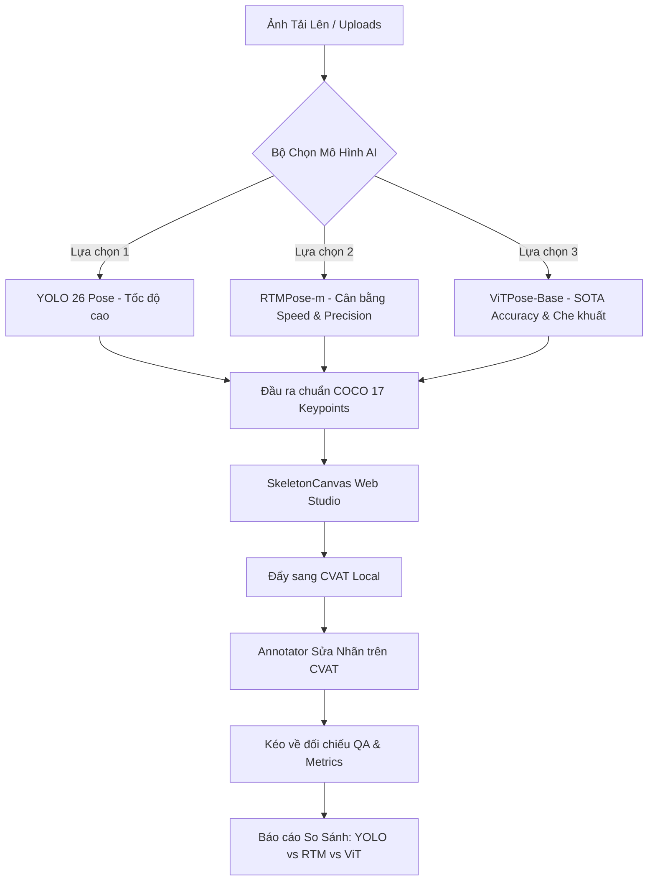

# Đề Xuất Kiến Trúc & Kế Hoạch Tích Hợp: YOLO-Pose vs RTMPose vs ViTPose
> **Dự án:** PosePreLabel AI Platform (T-16)  
> **Mục tiêu:** So sánh hiệu quả Pre-label, Tỷ lệ annotator phải sửa (Human Correction Rate), và Đánh giá chất lượng sau Retraining giữa 3 trường phái mô hình Pose hàng đầu.

---

## 1. Tổng Quan & So Sánh 3 Kiến Trúc Mô Hình

| Tiêu chí | **YOLO-Pose (YOLO26 / YOLO11)** | **RTMPose (OpenMMLab 2023)** | **ViTPose (NeurIPS 2022 / 2023)** |
| :--- | :--- | :--- | :--- |
| **Trường phái kiến trúc** | One-stage CNN (Anchor-free Head) | Top-down CNN + SimCC (1D Classification) | Vision Transformer (ViT Backbone + Plain Head) |
| **Năm công bố** | 2023 - 2024 (Ultralytics) | **CVPR 2023** (OpenMMLab) | **NeurIPS 2022 / ViTPose+ 2023** |
| **Độ chính xác (COCO AP)** | ~70.0% - 74.9% (m / x) | **75.8% - 76.5%** (m / l) | **75.8% (Base) - 80.9% (Huge)** *(SOTA)* |
| **Khả năng xử lý Bị che (Occlusion)** | Khá (Dễ bị lệch khi tay/chân bị che khuất sâu) | **Rất tốt** (Nhờ SimCC biểu diễn tọa độ 1D mịn) | **Xuất sắc nhất** (Self-attention bao quát cấu trúc giải phẫu toàn cơ thể) |
| **Tốc độ suy luận (Inference)** | **Siêu nhanh** (80 - 120+ FPS trên GPU) | **Rất nhanh** (70 - 90+ FPS trên GPU) | **Trung bình - Chậm** (15 - 25 FPS trên GPU, nặng trên CPU) |
| **Yêu cầu phần cứng** | Rất nhẹ, chạy tốt trên CPU & GPU yếu | Nhẹ - Trung bình (VRAM ~2GB) | Nặng (Cần GPU có VRAM ≥ 4-6GB) |
| **Thư viện có sẵn (Không tự code)** | `ultralytics` | `rtmlib` / `onnxruntime` (Pretrained ONNX COCO 17) | Hugging Face `transformers` (`usyd-community/vitpose-base-simple`) |

---

## 2. Phân Tích & Đề Xuất Từ Góc Độ Senior AI Engineer

### 2.1. Con nào mới hơn? Con nào có độ chuẩn xác cao hơn?
1. **Về độ chuẩn xác (Accuracy & Occlusion Robustness):**
   - 🏆 **ViTPose là "Ông vua" về độ chính xác.** Với cơ chế **Multi-Head Self-Attention**, ViTPose hiểu được mối liên kết không gian toàn cục của cơ thể người. Trong khoang lái ô tô (Driver Cabin), khi cánh tay bị vô lăng che, hoặc chân bị bảng điều khiển/cửa xe che, ViTPose vẫn suy luận vị trí khớp cực kỳ chính xác dựa vào tư thế của vai, đầu và cột sống.
   - **RTMPose** đứng thứ 2 về độ chuẩn xác (chỉ kém ViTPose-Huge một chút), nhưng **vượt trội hơn hẳn YOLO** ở các khớp khó (cổ tay, khuỷu tay, mắt cá).

2. **Về tính mới & Tối ưu thực tế (Engineering Trade-off):**
   - **RTMPose (CVPR 2023)** mới hơn bản gốc của ViTPose (2022). Đột phá của RTMPose là phát minh ra kỹ thuật **SimCC** (biến bài toán tìm heatmap 2D tốn kém thành phân loại tọa độ 1D $x$ và $y$ liên tục).
   - **ViTPose+ (2023)** là bản nâng cấp đa tác vụ của ViTPose.

### 2.2. Đề xuất lựa chọn Pre-trained Model (Sẵn có, không tự code):
Để dự án chạy mượt mà, **không bị lỗi cài đặt C++ trên môi trường Windows (tránh lỗi `mmcv` khét tiếng)**, giải pháp chuẩn production là:

1. **Với ViTPose:**
   - Sử dụng model chính thức trên **Hugging Face Hub**: `usyd-community/vitpose-base-simple` (hoặc `vitpose-large-simple`).
   - Cài đặt sẵn qua thư viện: `pip install transformers torch torchvision`.
   - Gọi inference trực tiếp với pipeline có sẵn của Hugging Face chỉ với vài dòng wrapper.

2. **Với RTMPose:**
   - Sử dụng thư viện siêu nhẹ chuyên dụng: `rtmlib` (do nhóm OpenMMLab phát triển độc lập cho ONNX Runtime).
   - Cài đặt: `pip install rtmlib onnxruntime` (hoặc `onnxruntime-gpu`).
   - Tự động tải trọng số chính thức `rtmpose-m` hoặc `rtmpose-l` (COCO 17 keypoints), chạy trực tiếp trên ONNX Runtime, tốc độ cực cao và hoàn toàn miễn nhiễm với lỗi môi trường Windows!

---

## 3. Kiến Trúc Tích Hợp Dự Kiến Vào Hệ Thống Hiện Tại

### 3.1. Thiết kế Giao diện (UI Dropdown Selector):
- Tại thanh bên trái của **Pre-label Studio**, bổ sung Dropdown:
  - ⚡ `YOLO 26 Pose` *(Mặc định - Realtime)*
  - 🎯 `RTMPose-m (OpenMMLab)` *(Chuẩn xác cao, xử lý nét đứt/che tốt)*
  - 🧠 `ViTPose-Base (Vision Transformer)` *(Độ chính xác tối đa, tự suy luận tư thế phức tạp)*
- Khi chọn model nào và bấm **Chạy Pre-label**, hệ thống sẽ gọi engine tương ứng và lưu nhãn dự đoán.

### 3.2. Bảng So Sánh Đo Lường (Benchmark & Metrics Dashboard):
Ở trang **Quality & Metrics**, hệ thống sẽ tổng hợp bảng so sánh trên cùng một tập ảnh:
1. **Tốc độ suy luận (Inference Latency):** ms / ảnh.
2. **PCK@0.2 Score:** Tỷ lệ khớp xương dự đoán đúng chuẩn Ground Truth.
3. **Human Correction Rate (%):** Tỷ lệ điểm người gán nhãn phải chỉnh sửa lại trên CVAT.  
   *(Kỳ vọng: ViTPose sẽ có Correction Rate thấp nhất vì ít sai nhất).*
4. **NME (Normalized Mean Error):** Độ lệch khoảng cách trung bình.

---

## 4. Kế Hoạch Đánh Giá Sau Khi Retraining (Active Learning)

Sau khi Annotator chỉnh sửa nhãn chuẩn xác trên CVAT và xuất ra tập dữ liệu (`data/datasets/`):
- **Giai đoạn 1 (Fine-tune):**
  - Fine-tune YOLO-Pose trên dataset đã sửa.
  - Fine-tune RTMPose trên dataset đã sửa.
  - Fine-tune ViTPose trên dataset đã sửa.
- **Giai đoạn 2 (Đánh giá Validation):**
  - Đo độ tăng trưởng mAP (AP gain) của từng con trên tập Test ẩn.
  - **Giả thuyết khoa học:** 
    - YOLO sẽ tăng trưởng nhanh nhất ở các tư thế người bình thường.
    - ViTPose sẽ đạt trần hiệu năng (Performance Ceiling) cao nhất trong các ca tư thế khó và bị che khuất nặng trong xe.

---

## 5. Kết Luận & Đề Xuất Tiếp Theo
- Ý tưởng tích hợp thêm **RTMPose** và **ViTPose** của bạn là **rất xuất sắc và mang tính nghiên cứu/công nghiệp cao**. Nó biến hệ thống từ một công cụ đơn lẻ thành một **Nền tảng Thử nghiệm & Đánh giá Đa Mô hình (Multi-Model AI Benchmark Studio)**.
- Khi triển khai, chúng ta sẽ giữ nguyên toàn bộ kiến trúc đang hoạt động ổn định của YOLO và CVAT, chỉ mở rộng thêm Service Provider cho 2 mô hình mới.
