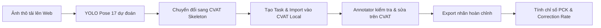

# POSE-PRELABEL-APP: TÀI LIỆU ĐẶC TẢ DỰ ÁN VÀ THIẾT KẾ KIẾN TRÚC
> **Dự án**: Nền tảng tự động tiền gán nhãn Pose (Keypoints) tích hợp YOLO Pose & CVAT Local  
> **Phiên bản tài liệu**: 1.1 (Đã thống nhất: 17 Keypoints COCO, React + Tailwind, FastAPI)  
> **Cấu trúc thư mục tham chiếu**: `pose-prelabel-app/`

---

## 1. GÓC NHÌN PRODUCT MANAGER (PM)

### 1.1. Bối cảnh & Vấn đề (Problem Statement)
* **Thực trạng**: Gán nhãn thủ công khung xương người 17 điểm cực kỳ tốn thời gian (trung bình 1.5 - 2 phút/người). Người gán nhãn (Annotator) dễ mỏi mắt, sai lệch vị trí khớp và sót các điểm bị che khuất (occluded).
* **Mục tiêu**: Sử dụng mô hình **YOLO Pose (17 keypoints chuẩn COCO)** để **tự động gán nhãn sơ bộ (Pre-labeling)**, sau đó đồng bộ trực tiếp sang nền tảng **CVAT Local**.
* **Lợi ích & KPIs cốt lõi**:
  1. **Cắt giảm 65% - 75%** thời gian gán nhãn thủ công trên từng ảnh.
  2. **Quy trình Human-in-the-loop**: Annotator chỉ việc tinh chỉnh (refine) điểm lệch thay vì chấm điểm từ con số không.
  3. **Đo lường & Kiểm soát**: Theo dõi độ chính xác của model và khối lượng công việc annotator phải sửa đổi thông qua chỉ số *Correction Rate*.

### 1.2. Chân dung người dùng (User Personas)
* **Data Annotator**: Nhận task đã có sẵn khung xương dự đoán trên CVAT, chỉ cần kéo chỉnh khớp lệch, gán nhãn điểm che khuất.
* **QA / Annotation Lead**: Theo dõi tiến độ gán nhãn, đánh giá chất lượng qua báo cáo sai số (PCK, NME, tỉ lệ sửa đổi).
* **AI / ML Engineer**: Thu thập lại dữ liệu đã được con người chỉnh sửa chuẩn xác từ CVAT để phục vụ vòng lặp huấn luyện lại (Continuous Retraining).

### 1.3. Lộ trình phát triển sản phẩm (Roadmap)
* **Giai đoạn 1 (MVP)**:
  - Tải lên ảnh / thư mục ảnh $\rightarrow$ Backend chạy YOLO Pose 17 keypoints $\rightarrow$ Xuất định dạng CVAT.
  - Tự động tạo Task trên CVAT Local qua CVAT SDK/API và import ảnh kèm nhãn.
* **Giai đoạn 2 (Feedback & Metrics Loop)**:
  - Khi annotator hoàn thành trên CVAT, hệ thống kéo nhãn Ground Truth về.
  - Module `metrics.py` tính toán PCK, NME và tỷ lệ điểm bị annotator can thiệp sửa đổi.
* **Giai đoạn 3 (Nâng cao)**:
  - Hỗ trợ video tracking skeleton (bảo toàn ID người qua các frame).
  - Tự động lọc các ca khó (Confidence score thấp) để ưu tiên annotator review.

---

## 2. GÓC NHÌN DATA ANNOTATION SPECIALIST

### 2.1. Phân loại 17 Keypoints (Chuẩn COCO Keypoints)
Sử dụng bộ 17 điểm giải phẫu tiêu chuẩn COCO:
* **Mặt & Đầu (5 điểm)**:
  - `0`: Mũi (Nose)
  - `1`: Mắt trái (Left Eye), `2`: Mắt phải (Right Eye)
  - `3`: Tai trái (Left Ear), `4`: Tai phải (Right Ear)
* **Chi trên (6 điểm)**:
  - `5`: Vai trái (Left Shoulder), `6`: Vai phải (Right Shoulder)
  - `7`: Khuỷu tay trái (Left Elbow), `8`: Khuỷu tay phải (Right Elbow)
  - `9`: Cổ tay trái (Left Wrist), `10`: Cổ tay phải (Right Wrist)
* **Chi dưới (6 điểm)**:
  - `11`: Hông trái (Left Hip), `12`: Hông phải (Right Hip)
  - `13`: Đầu gối trái (Left Knee), `14`: Đầu gối phải (Right Knee)
  - `15`: Cổ chân trái (Left Ankle), `16`: Cổ chân phải (Right Ankle)

### 2.2. Quy ước trạng thái hiển thị (Visibility Flags)
Tuân thủ chuẩn COCO / CVAT format:
* `0` (Unlabeled / Ngoài ảnh): Điểm nằm ngoài khung hình hoặc hoàn toàn không xác định được.
* `1` (Labeled but Occluded): Điểm bị che khuất bởi đồ vật hoặc cơ thể tự che, annotator cần ước đoán vị trí.
* `2` (Labeled and Visible): Điểm nhìn thấy rõ ràng trên ảnh.

### 2.3. Quy trình làm việc chuẩn (Standard Operating Procedure - SOP)

1. **Kiểm tra Hộp bao (Bounding Box)**: Xóa các dự đoán người bị nhận diện nhầm (False Positive).
2. **Kiểm tra Đường nối xương (Bones)**: Đảm bảo không bị lộn chi (trái/phải).
3. **Hiệu chỉnh Tọa độ**: Kéo các điểm bị lệch về đúng tâm khớp giải phẫu.
4. **Cập nhật Cờ Occlusion**: Đánh dấu điểm bị che để thuật toán học tốt hơn.

### 2.4. Tiêu chí đánh giá chất lượng (Annotation Metrics)
* **PCK (Percentage of Correct Keypoints)**: Tỷ lệ phần trăm các điểm dự đoán rơi vào vùng bán kính dung sai cho phép (thường lấy ngưỡng $\alpha \times \text{kích thước Bounding Box}$).
* **NME (Normalized Mean Error)**: Sai số khoảng cách Euclid trung bình giữa điểm model sinh ra và điểm Ground Truth sau khi annotator chốt.
* **Human Correction Rate (% Sửa đổi)**:
  $$\text{Correction Rate} = \frac{\text{Số keypoints annotator dịch chuyển} > \text{threshold}}{\text{Tổng số keypoints}}$$

---

## 3. GÓC NHÌN SOFTWARE ENGINEER (SE)

### 3.1. Công nghệ được chốt (Tech Stack)
* **Frontend**: **React (Vite) + Tailwind CSS**
  - Giao diện Dashboard hiện đại, hỗ trợ Dark/Light mode.
  - Component Upload kéo thả nhiều file/folder.
  - Interactive Canvas Preview: Hiển thị ảnh chụp có vẽ khung xương 17 điểm với màu sắc sinh động trước khi đẩy sang CVAT.
  - Bảng điều khiển tác vụ CVAT: Tạo task, xem trạng thái sync, link mở trực tiếp job trong CVAT.
  - Dashboard Metrics trực quan (biểu đồ thống kê PCK, NME, Correction Rate).
* **Backend**: **FastAPI (Python 3.10+)**
  - Khung xử lý async, tích hợp `BackgroundTasks` cho inference batch và upload CVAT.
  - Tự động sinh Swagger UI API docs (`/docs`).
* **AI Model Engine**: **YOLO 26 Pose** (17 keypoints COCO).
* **Annotation Platform**: **CVAT Local** (kết nối qua `cvat-sdk` và REST API v2).

### 3.2. Cấu trúc thư mục dự án

```
pose-prelabel-app/
├── backend/
│   ├── weights/           # Chứa weights YOLO 26 Pose (yolo26-pose.pt)
│   ├── config.py          # Biến môi trường, cấu hình CVAT & app
│   ├── schemas.py         # Pydantic models validate dữ liệu
│   ├── model_service.py   # Load & Inference YOLO 26 Pose (GPU/CPU)
│   ├── converter.py       # Transform YOLO 17 Keypoints -> CVAT Skeleton Format
│   ├── cvat_client.py     # Wrapper gọi CVAT SDK / REST API v2 (tạo task, push nhãn)
│   ├── metrics.py         # Tính toán PCK, NME, Correction Rate
│   ├── train_yolo26.py    # [MỚI] Script huấn luyện / fine-tune lại YOLO 26 với Ground Truth
│   ├── main.py            # FastAPI REST API & Routing
│   └── requirements.txt   # fastapi, uvicorn, cvat-sdk, opencv-python,...
├── frontend/              # Ứng dụng React (Vite) + Tailwind CSS
│   ├── src/
│   │   ├── layouts/       # Khung sườn cố định (MainLayout, Sidebar, Header)
│   │   ├── views/         # Màn hình chính (StudioView, CVATSyncView, AnalyticsView)
│   │   ├── components/    # Reusable widgets (SkeletonCanvas, CanvasToolbar, UI primitives)
│   │   ├── services/      # api.js gọi Backend REST API
│   │   ├── App.jsx
│   │   └── index.css      # Tailwind directives & styles
│   ├── package.json
│   └── vite.config.js
├── data/
│   ├── uploads/           # Lưu ảnh gốc được tải lên
│   ├── outputs/           # Lưu kết quả pre-label JSON, cache tạm
│   └── datasets/          # [MỚI] Lưu dataset xuất từ CVAT chuẩn YOLO Pose (train/val/data.yaml)
├── docker-compose.yml     # Khởi chạy đồng bộ App Backend + CVAT Local Stack (tuỳ chọn)
└── README.md
```

### 3.3. Chi tiết logic các Module Backend
1. **`model_service.py`**:
   - Tải trọng số `yolo26-pose.pt` (hoặc file checkpoint YOLO 26 của bạn).
   - Hàm `predict_batch(image_paths, conf=0.5, kpt_conf=0.5)` trả về mảng bounding box và 17 keypoints `(x, y, conf)`.
2. **`converter.py`**:
   - Ánh xạ 17 điểm của YOLO sang đúng định dạng **CVAT Skeleton Shape** tương ứng bộ nhãn COCO Keypoints của CVAT.
   - Thiết lập các đường nối (bones) chuẩn giữa các khớp.
3. **`cvat_client.py`**:
   - `login(host, username, password)`
   - `create_task_with_coco_skeleton(task_name)`
   - `upload_task_data(task_id, images)`
   - `upload_annotations(task_id, annotations)`
   - `download_ground_truth(task_id)`
4. **`metrics.py`**:
   - Ghép cặp prediction và ground-truth bằng Hungarian Algorithm (dựa trên khoảng cách bounding box và OKS).
   - Xuất thống kê chi tiết theo từng khớp (khớp nào annotator phải sửa nhiều nhất).
5. **`train_yolo26.py` & Dataset Exporter [MỚI]**:
   - Tải bộ dữ liệu Ground Truth đã được annotator sửa chuẩn từ CVAT.
   - Tự động chia tỉ lệ Train/Val (80/20), sinh cấu trúc thư mục YOLO Pose kèm file `data.yaml`.
   - Script chạy huấn luyện fine-tune YOLO 26, tự động lưu model tốt nhất vào `weights/yolo26-pose.pt`.

---

## 4. BẢNG PHÂN TÍCH RỦI RO & GIẢI PHÁP (RISK MATRIX)

| STT | Rủi ro kỹ thuật | Mức độ | Biện pháp giải quyết |
|:---:|---|:---:|---|
| 1 | Lệch thứ tự 17 điểm giữa YOLO và CVAT | **Thấp** | Cả hai đều dùng chuẩn COCO 17 điểm, đảm bảo mapping 1:1 chính xác tuyệt đối. |
| 2 | Timeout khi upload batch ảnh lớn vào CVAT | **Trung bình** | Sử dụng `BackgroundTasks` của FastAPI, client nhận task_id và query trạng thái qua SSE hoặc polling. |
| 3 | Người dùng chưa có sẵn CVAT Local | **Trung bình** | Cung cấp sẵn hướng dẫn và cấu hình `docker-compose.yml` để dựng CVAT Local chỉ với 1 câu lệnh. |
